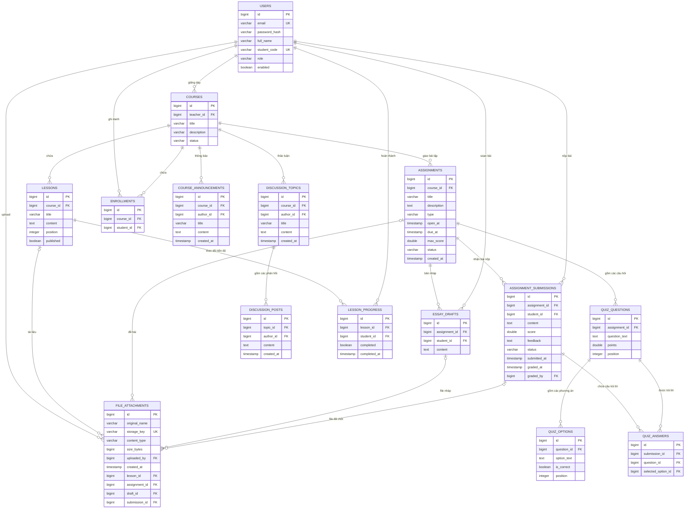

# Kiến trúc cơ sở dữ liệu LMS (Flyway V1–V3)

V3 bổ sung `essay_drafts` (bản nháp tự luận riêng, unique assignment_id + student_id)
và `file_attachments` (metadata file). Tất cả khóa chính tiếp tục dùng BIGINT IDENTITY.
Nội dung file nằm trên ổ đĩa, không phải BLOB trong PostgreSQL.
`file_attachments` có bốn FK nullable: lesson_id, assignment_id, draft_id, submission_id;
CHECK bắt buộc đúng một FK có giá trị. Các FK này ON DELETE CASCADE.
Khi nộp bài, draft_id chuyển thành submission_id rồi bản nháp được xóa trong cùng giao dịch.

## Các ràng buộc và tối ưu:
- `uq_enrollment`: Unique `(course_id, student_id)` ngăn ghi danh trùng lặp.
- `uq_assignment_student`: Unique `(assignment_id, student_id)` ngăn một sinh viên nộp trùng nhiều bài nộp trong cùng bài tập.
- `uq_submission_question`: Unique `(submission_id, question_id)` ngăn sinh viên gửi trùng câu trả lời cho cùng câu hỏi.
- `uq_lesson_student`: Unique `(lesson_id, student_id)` lưu trạng thái hoàn thành bài học của sinh viên.
- Các bảng sử dụng ID tham chiếu độc lập, đảm bảo query JPA nhanh chóng, không bị N+1 hay lazy load ngoài ý muốn. Foreign key được database PostgreSQL và H2 kiểm tra toàn vẹn ở tầng lưu trữ.
