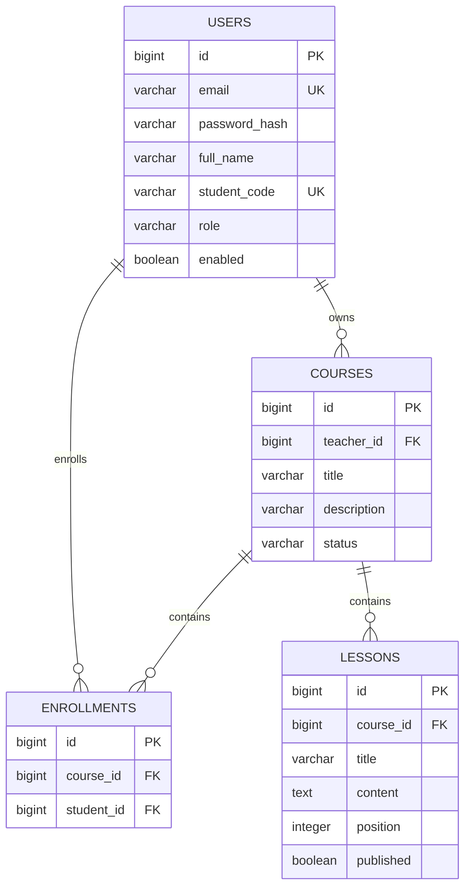

# Database của base

Unique (course_id, student_id) ngăn ghi danh trùng. Quan hệ lưu dưới dạng ID trong entity để code đơn giản và không có lazy-loading ngoài ý muốn. Foreign key vẫn được database kiểm tra.

Chỉ triển khai bốn bảng phục vụ lát cắt hiện tại. Quiz/attempt/answer/receipt và timestamp audit sẽ có migration riêng khi triển khai phần tương ứng trong plan.
